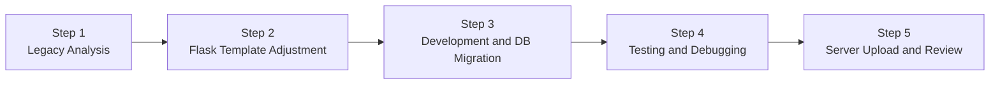
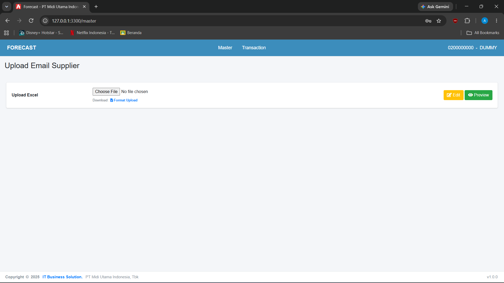
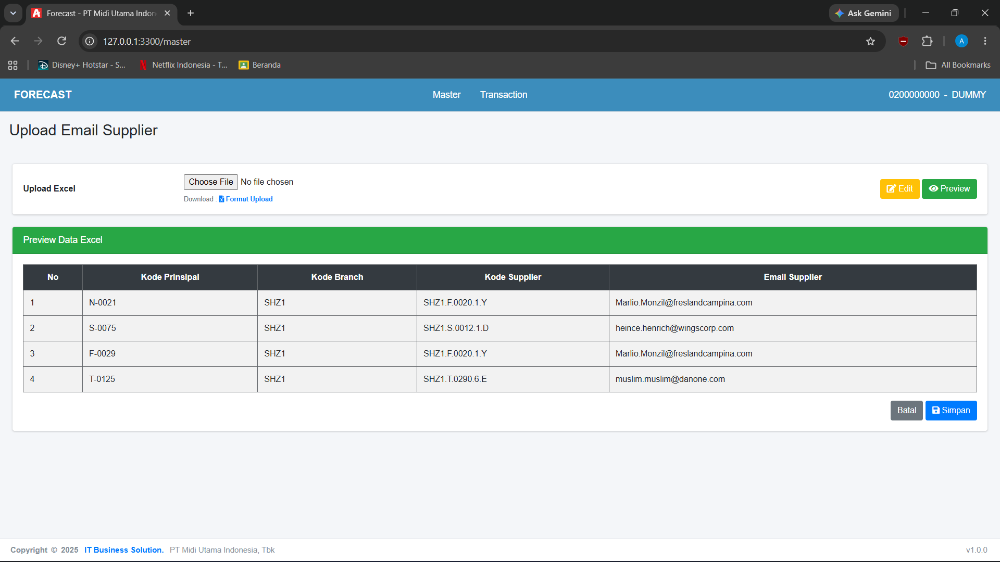
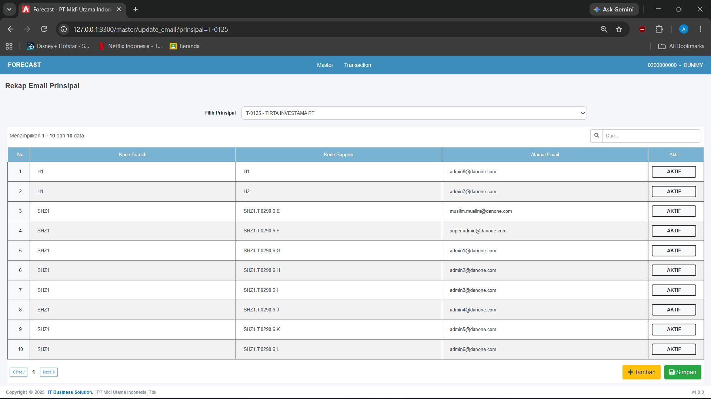
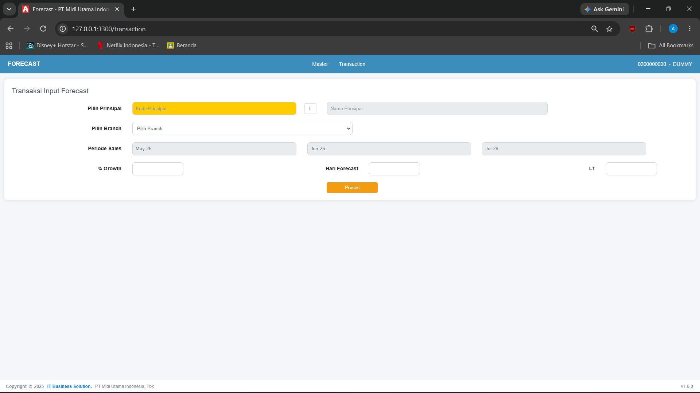
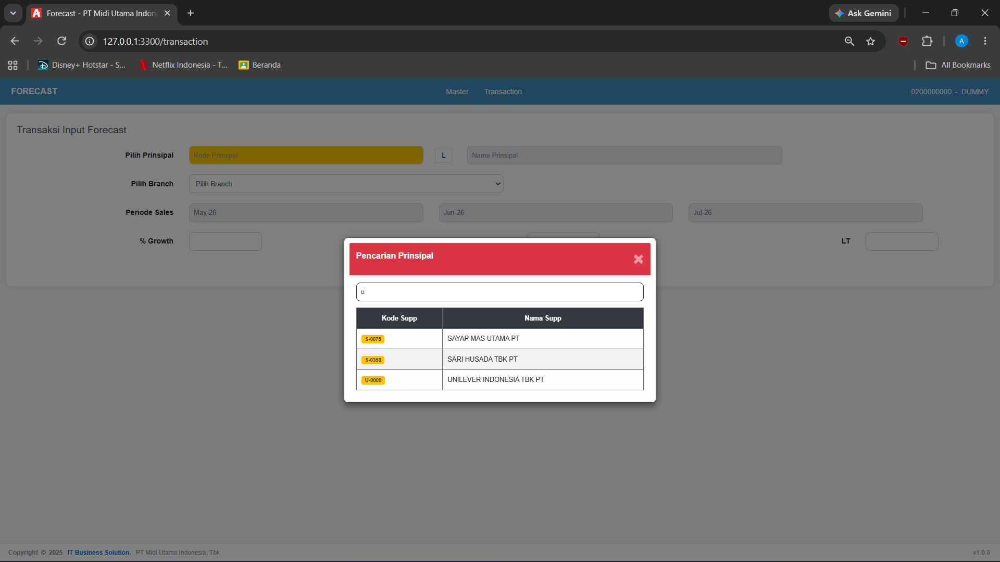
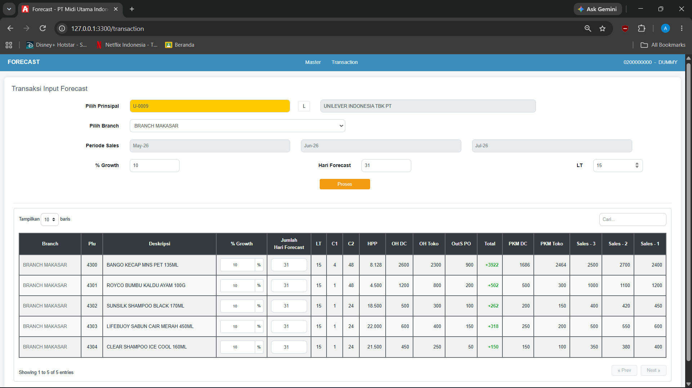
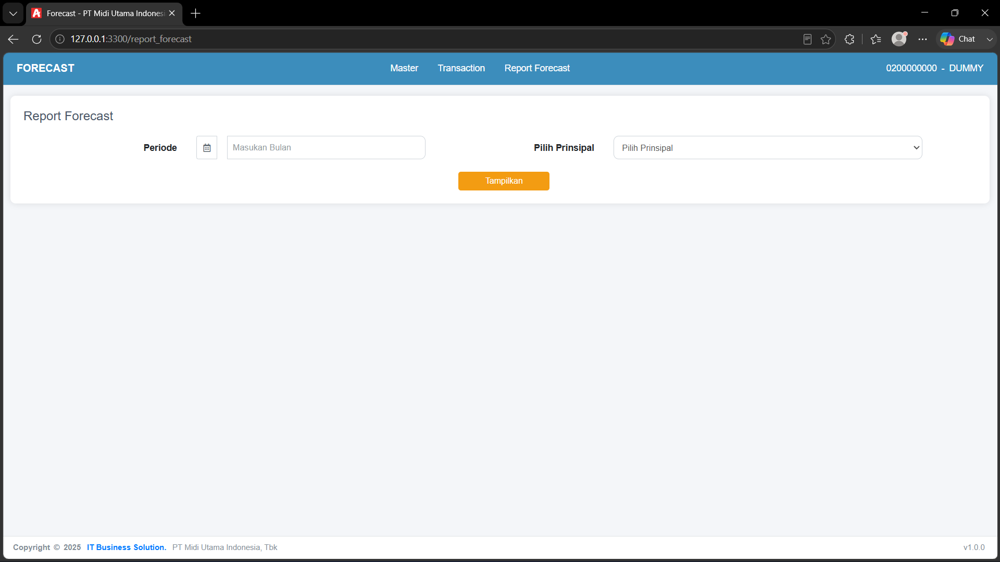
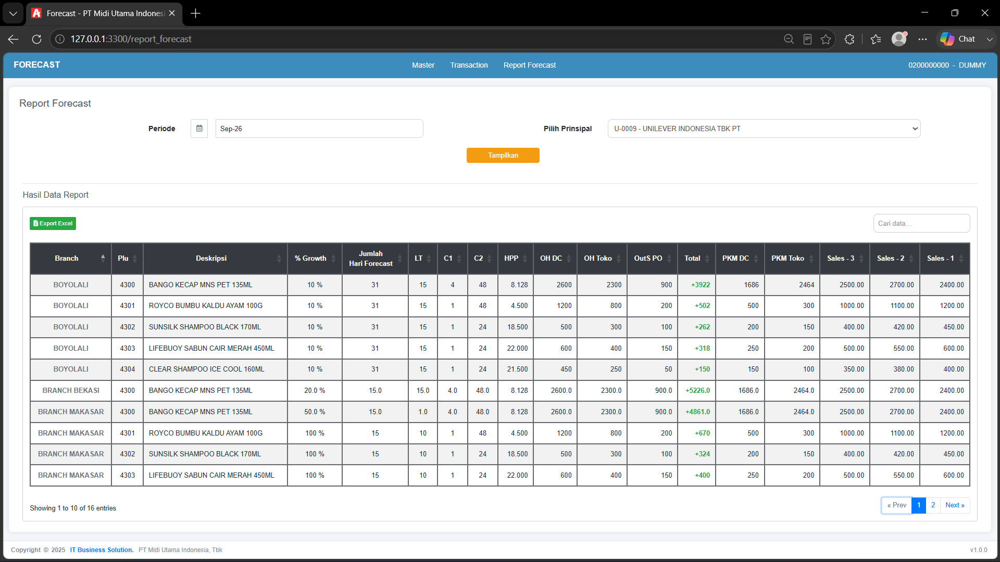

# 📈 Internal Application Migration
### Sales Forecasting System

*Portfolio case study — IT Back Office Internship*

 

 

**Native PHP + Oracle** &nbsp;➜&nbsp; **Python Flask + PostgreSQL**

---

## 📑 Daftar Isi

- [Project Overview](#-project-overview)
- [Project Information](#-project-information)
- [Application Features](#-application-features)
- [My Contributions](#-my-contributions)
- [Migration Process](#-migration-process)
- [Project Screenshots](#-project-screenshots)
- [Skills & Learning Outcomes](#-skills--learning-outcomes)
- [Disclaimer](#-disclaimer)

---

## 🎯 Project Overview

Project ini mendokumentasikan pengalaman **migrasi aplikasi internal** yang mendukung proses pengelolaan forecast penjualan. Berdasarkan dokumen kebutuhan fitur, aplikasi mencakup pengelolaan master supplier, pengaturan email supplier, pemilihan prinsipal, serta pemrosesan dan peninjauan hasil forecast bulanan.

> [!NOTE]
> Repository ini merupakan **dokumentasi portofolio**, bukan repository source code atau aplikasi yang dapat dijalankan.

---

## 🧾 Project Information

| 📌 Informasi | 📝 Detail |
| :-- | :-- |
| **Project Type** | Internal Application Migration |
| **Role** | IT Back Office Intern |
| **Frontend** | HTML, CSS, JavaScript |
| **Legacy Backend** | Native PHP |
| **Migrated Backend** | Python (Flask) |
| **Legacy Database** | Oracle |
| **Target Database** | PostgreSQL |

### 🔄 Before & After

| | Legacy | Migrated |
| :-- | :--: | :--: |
| **Backend** | Native PHP | Python Flask |
| **Database** | Oracle | PostgreSQL |

---

## ✨ Application Features

| # | Fitur | Deskripsi |
| :-: | :-- | :-- |
| 1 | 📤 **Supplier Master Upload** | Mengunggah data master supplier dari file spreadsheet, meninjau data melalui preview, kemudian menyimpan data. |
| 2 | ✉️ **Supplier Email Management** | Mengelola alamat email supplier, termasuk penambahan dan pembaruan status aktif/nonaktif. |
| 3 | 🔍 **Principal Selection** | Pencarian dan pemilihan prinsipal untuk kebutuhan proses aplikasi. |
| 4 | 📅 **Monthly Sales Forecast** | Memilih periode penjualan, memproses data forecast, serta meninjau dan mengubah parameter tertentu pada hasil forecast. |
| 5 | 📊 **Report Data Forecast** | Menampilkan dan meninjau laporan hasil forecast yang telah diproses sebagai referensi perencanaan kebutuhan persediaan barang. |

---

## 🛠️ My Contributions

Selama magang, kontribusi saya mencakup:

- 🔁 Migrasi implementasi aplikasi dari **Native PHP** ke **Python Flask**.
- 🗄️ Penyesuaian query dan struktur data dari **Oracle** ke **PostgreSQL**.
- 🐞 Debugging dan testing fitur setelah proses migrasi.
- 🚀 Penyerahan/deployment hasil migrasi ke lingkungan server internal perusahaan.

---

## 🧭 Migration Process

Proses migrasi dilakukan secara bertahap, mulai dari mempelajari sistem lama, menyesuaikan template Flask, mengembangkan kode baru dan menyesuaikan query database, hingga pengujian serta pengunggahan hasil migrasi ke server internal perusahaan untuk diperiksa oleh atasan.

<b>1️⃣ Legacy Application Analysis</b>

 

Mempelajari aplikasi lama yang dibangun menggunakan Native PHP dan Oracle untuk memahami alur kerja, fungsionalitas, serta proses pengolahan data sebagai dasar dalam melakukan migrasi.

<b>2️⃣ Flask Template Adjustment</b>

 

Menyesuaikan template aplikasi Flask yang telah disediakan perusahaan agar sesuai dengan kebutuhan dan struktur aplikasi Forecast Penjualan yang akan dimigrasikan.

<b>3️⃣ Application Development & Database Migration</b>

 

Mengembangkan kode backend baru menggunakan Python Flask berdasarkan fungsionalitas aplikasi sebelumnya, sekaligus melakukan penyesuaian query SQL dari Oracle ke PostgreSQL agar proses pengolahan data dapat berjalan pada lingkungan database yang baru.

<b>4️⃣ Application Testing & Debugging</b>

 

Melakukan pengujian terhadap aplikasi hasil migrasi untuk memastikan fitur dan proses pengolahan data berjalan sesuai kebutuhan. Apabila ditemukan error atau ketidaksesuaian, dilakukan debugging dan perbaikan pada aplikasi.

<b>5️⃣ Server Upload & Review</b>

 

Mengunggah file aplikasi hasil migrasi ke server internal perusahaan menggunakan **WinSCP** untuk kemudian dilakukan pemeriksaan dan evaluasi oleh atasan.

---

## 🖼️ Project Screenshots

### ✉️ Supplier Email Management

#### Upload Email Supplier

  

> Halaman untuk mengunggah data email supplier melalui file Excel sesuai format yang ditentukan. Pengguna dapat mengunduh template Excel, memilih file yang akan diunggah, dan melakukan preview untuk meninjau data sebelum diproses. Tersedia juga tombol **Edit** untuk mengakses fitur pengelolaan data email supplier.

#### Preview Email Supplier

  

> Menampilkan hasil preview data email supplier dari file Excel sebelum disimpan ke database. Data ditampilkan dalam tabel yang mencakup kode prinsipal, kode branch, kode supplier, dan alamat email supplier. Pengguna dapat meninjau kesesuaian data lalu menyimpan melalui tombol **Simpan** atau membatalkan melalui tombol **Batal**.

#### Edit Email Supplier

  

> Digunakan untuk mengelola data email supplier berdasarkan prinsipal yang dipilih. Pengguna dapat melihat daftar email supplier beserta kode branch, kode supplier, dan status aktifnya, serta memakai fitur pencarian, penambahan email baru, dan pengaturan status aktif/nonaktif sebelum perubahan disimpan.

---

### 📅 Monthly Sales Forecast

#### Input Forecast

  

> Halaman untuk melakukan perhitungan forecast penjualan berdasarkan parameter dari pengguna. Pengguna memilih prinsipal dan branch, lalu memasukkan parameter seperti persentase pertumbuhan (**Growth**), jumlah hari forecast, dan **Lead Time (LT)**. Halaman ini juga menampilkan periode data penjualan yang menjadi acuan. Proses dijalankan melalui tombol **Proses**.

#### Search Prinsipal

  

> Fitur pencarian prinsipal melalui pop-up pada halaman Transaksi Input Forecast. Pengguna dapat mencari berdasarkan kode atau nama prinsipal, lalu sistem menampilkan daftar yang sesuai dalam bentuk tabel. Prinsipal yang dipilih digunakan untuk melanjutkan proses input forecast.

#### Proses Forecast

  

> Menampilkan hasil pengolahan data forecast berdasarkan prinsipal, branch, periode penjualan, dan parameter yang telah ditentukan. Hasil disajikan dalam tabel yang mencakup informasi produk, Growth, jumlah hari forecast, Lead Time (LT), data stok, serta riwayat penjualan tiga bulan sebelumnya. User juga dapat menyesuaikan Growth dan jumlah hari forecast pada setiap produk untuk mendukung perencanaan kebutuhan persediaan barang.

---

### 📊 Report Data Forecast

#### Report Forecast

  

> Halaman untuk menampilkan laporan hasil forecast berdasarkan periode dan prinsipal yang dipilih. User menentukan bulan laporan dan memilih prinsipal melalui dropdown, kemudian menekan tombol **Tampilkan** untuk melihat data sesuai parameter.

#### Data Report Forecast

  

> Menampilkan hasil laporan forecast berdasarkan periode dan prinsipal yang dipilih. Data disajikan dalam tabel yang mencakup informasi produk, branch, Growth, jumlah hari forecast, Lead Time (LT), data stok, serta riwayat penjualan tiga bulan sebelumnya. Tersedia fitur pencarian, pengurutan data, pagination, dan **Export Excel** untuk memudahkan peninjauan serta pengunduhan laporan.

---

## 🎓 Skills & Learning Outcomes

| Area | Keterampilan |
| :-- | :-- |
| 🐍 **Backend** | Python and Flask application development |
| 🗄️ **Database** | SQL query adaptation for PostgreSQL, relational database migration |
| 🧪 **Quality** | Debugging and functional testing |
| 🏢 **Business** | Working with internal business applications |

---

## ⚠️ Disclaimer

> [!IMPORTANT]
> Repository ini dibuat untuk mendokumentasikan pengalaman dan kontribusi selama magang. **Source code, database, kredensial, konfigurasi server, dan informasi internal perusahaan tidak disertakan.**

Dibuat sebagai dokumentasi portofolio • IT Back Office Internship

